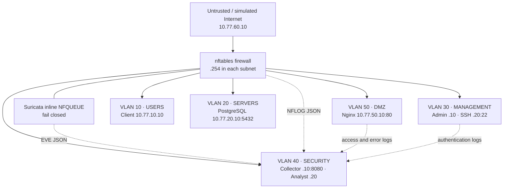

# Enterprise Network Security Lab

A runnable small-enterprise security lab with five VLAN-equivalent segments, a
stateful default-deny firewall, inline Suricata IDS/IPS, real network services,
centralized logs, and live security regression tests. Attack traffic stays inside
six isolated Docker bridges. The Internet is a **local simulation**.

## Architecture



Docker bridges represent separate broadcast domains; this is **logical VLAN
segmentation**, not 802.1Q tagging. Suricata is operated as the security sensor but
shares the firewall's network namespace to inspect routed packets. Same-VLAN
traffic does not traverse the router; SSH has an endpoint firewall as well.

## Technologies and prerequisites

- Native Linux, rootful Docker Engine 28+ and Docker Compose v2.24+ (`--wait`).
- Kernel support for nftables, NFQUEUE and NFLOG; `NET_ADMIN` and `NET_RAW` inside
  containers. No privileged containers, Docker socket mounts, or host networking.
- Python 3.10+, venv/pip, GNU Make, OpenSSL and OpenSSH client on the host.
- Allocate about 2 CPU cores, 2 GB available RAM and 3 GB disk for building and logs.
- Debian Trixie container image, nftables, Suricata 7, Nginx, PostgreSQL 17,
  OpenSSH, Python/SQLite, Nmap and pytest. One shared image keeps the lab small.
- Ports need not be reserved unless using the optional localhost dashboard (8080).
- Six `10.77.{10,20,30,40,50,60}.0/24` subnets must not overlap existing networks.

On Debian/Ubuntu with Docker already installed:

```bash
sudo apt-get install make python3-venv python3-pip openssl openssh-client
```

Building downloads normal dependencies from Docker Hub, Debian and PyPI. Running
the lab and its tests requires no public connectivity. No script scans a public
target. Docker Desktop, rootless Docker, WSL and macOS are not validated targets;
a Linux VM is the reproducible fallback.

## Install and run

Run from this project's directory:

```bash
make setup
make up
make test
make security-audit
make attack-tests
make down
```

`make setup` checks prerequisites, generates private per-installation secrets,
creates `.venv`, validates Compose, and builds the image. `make up` waits for all
10 services to become healthy. `make down` removes only this lab's containers and
networks, retaining database/index volumes, secrets and source logs.

The equivalent main test command is:

```bash
source .venv/bin/activate
pytest -v
```

Tests require the running stack and intentionally fail if it is absent. They send
real TCP/HTTP/SSH/ICMP traffic; there are no mocked security controls. Run suites
serially because threshold rules and service state are shared.

## Use the services

No Docker container publishes a host port. Access occurs from authorized clients:

```bash
# Users -> DMZ and the local Internet simulation
 docker compose exec users curl http://10.77.50.10/
 docker compose exec users curl http://10.77.60.10/
# Trusted administrator -> SSH (first use: inspect and accept the lab host key)
 docker compose exec admin ssh -i /run/secrets/admin_key labadmin@10.77.30.20
# DMZ application identity -> real internal read-only inventory data
 docker compose exec web sh -c 'PGPASSWORD="$(cat /run/secrets/db_password)" psql -h 10.77.20.10 -U labapp -d lab -c "SELECT * FROM inventory"'
# Forbidden Users -> Management: expect timeout
 docker compose exec users curl --connect-timeout 2 telnet://10.77.30.20:22
```

Nginx serves static content and a real Basic Auth protected `/private` path. It
does not contain a vulnerable application. The DMZ database connection models an
application-tier dependency and is exercised by a real authenticated SQL query;
the static page itself does not query the database. Passwords are in ignored
`runtime/secrets/`, never checked into the project. SSH accepts a generated key;
password authentication is enabled only to demonstrate logged failures.

## Firewall and IDS

Only exact client/service pairs are allowed. Users reach DMZ HTTP and simulated
Internet HTTP; DMZ reaches only PostgreSQL internally; the administrator can reach
management and operational interfaces; the security client can perform monitoring.
Users and DMZ cannot reach management. Established replies are accepted using
conntrack. Source/subnet validation prevents cross-interface spoofing. All other
transit is dropped and rate-limited NFLOG events identify the rejecting policy.
See the complete [firewall policy](docs/firewall-policy.md).

Suricata inspects IPv4 traffic in NFQUEUE **before** the forward policy, so even
blocked probes can generate alerts. There is no queue bypass: losing Suricata
blocks routed traffic. Ten local signatures detect SYN bursts, SSH connection
bursts, sensitive HTTP paths, repeated HTTP 401 responses, ICMP bursts, database
probes and management-boundary violations. The harmless string
`ENS-LAB-MALWARE` in an HTTP URI is dropped by IPS. SSH payload encryption means
Suricata cannot read failed passwords; the SSH log provides that evidence.
See [IDS and traffic analysis](docs/ids-and-analysis.md).

## Logging and dashboard

Source logs are mounted read-only into the collector, which normalizes them into
SQLite with persistent offsets and a searchable HTTP API. It retains the latest
100,001 events. Original logs remain available under `runtime/logs/`:

| Source | Original evidence |
|---|---|
| Firewall | `firewall/events.jsonl`, decoded from real kernel NFLOG records |
| Suricata | `suricata/eve.json`, alerts, drops, HTTP, flow and stats |
| Nginx | `web/access.jsonl`, `web/error.log` |
| SSH | `ssh/auth.log`, accepted connections and failed authentication |

```bash
make dashboard
# Open http://127.0.0.1:8080 ; Ctrl-C stops the host-only proxy.

docker compose exec collector curl -s http://127.0.0.1:8080/api/summary
docker compose exec collector curl -s 'http://127.0.0.1:8080/api/events?source=suricata&sid=1000006'
```

The dashboard shows source counts, flow endpoints and expandable raw evidence.
It refreshes every five seconds. The optional Python proxy binds only to localhost
and retrieves data through `docker compose exec`. No separate Elasticsearch
installation or public web UI is needed. `/health` reports ingestion failure,
not just HTTP-process liveness.

## Attack simulations and testing

```bash
./scripts/attack.sh port-scan
./scripts/attack.sh ssh-bruteforce
./scripts/attack.sh http-recon
./scripts/attack.sh auth-failures
./scripts/attack.sh http-payload
./scripts/attack.sh unauthorized
./scripts/attack.sh dmz-management
./scripts/attack.sh users-management
./scripts/attack.sh icmp-scan
./scripts/attack.sh malware-marker
make attack-tests
make control-checks  # deliberately break/restore local controls to test the tests
```

Each scenario has a fixed local target. See [scenario commands and expected
results](docs/attack-scenarios.md). Assertions require new event IDs, timestamps
and source/destination identity, so stored alerts cannot satisfy an IDS test.
Forbidden-path tests first prove the target listener works from an allowed source,
then require a timeout rather than a refused connection. The audit checks running
containers, exact network attachments and addresses, exposed ports, service
listeners, router and endpoint policy drift, loaded rules and collector health,
then executes the full suite. `make control-checks` separately demonstrates that
a forbidden-flow test fails when its firewall rule is broken, that endpoint
policy deletion is detected, and that stopping Suricata blocks transit; it restores
all controls in cleanup handlers. JUnit reports are in
`reports/`. See [verification evidence](docs/verification.md).

## Security matrix

| Threat | Prevention | Detection | Response |
|---|---|---|---|
| Users lateral movement | Exact allowlist, default deny | SIDs 1000007/1000009, F99 | Isolate client; review allowed flows |
| DMZ pivot to management | Firewall and SSH endpoint ACL | SID 1000008, F99 | Stop DMZ; inspect logs and credentials |
| Reconnaissance | Restricted ports; no public route | SIDs 1000001/1000003/1000005 | Scope scan and investigate origin |
| SSH password guessing | Admin/security sources only; no root login | SID 1000002 plus real SSH failures | Disable source/access; rotate credentials |
| HTTP authentication abuse | Basic Auth; protected resources | SID 1000004 and Nginx errors | Review attempts; rotate affected credential |
| Suspicious web payload | Static service, URI parsing | SID 1000010 | Inspect URI and related flow |
| Test malware pattern | Inline drop | SID 1000006, EVE blocked action | Preserve event; confirm no origin access |
| Sensor failure | Fail-closed NFQUEUE | Healthcheck and connectivity tests | Restore sensor before transit |
| Policy drift | Runtime comparison and regression suite | Security audit failure | Restore policy; rerun tests |

## Troubleshooting

- Start with `docker compose ps`, `make logs`, and
  `docker compose logs firewall suricata collector`.
- `Operation not permitted` or missing NFQUEUE/NFLOG: use native rootful Docker on
  Linux. The host kernel must supply `nf_tables`, `nfnetlink_queue`, and
  `nfnetlink_log`; on a modular kernel an administrator can load these with
  `sudo modprobe MODULE`. Do not flush the host firewall.
- `Pool overlaps`: inspect `docker network ls` and `docker network inspect`.
  These documented fixed addresses are part of the tests; use a separate Linux
  VM if your host already uses them.
- Build package-download errors: confirm ordinary host Internet connectivity;
  runtime bridge isolation is intentional. Repeat `make setup` after restoring it.
- After configuration edits: `make setup && make down && make up`. A full recreate
  is needed for the sensor's shared router namespace. The audit rejects stale
  policy/rule files in an old image.
- Missing alerts: inspect `runtime/logs/suricata/suricata.log`; run
  `docker compose exec suricata suricatasc -c ruleset-stats /run/suricata-command.socket`.
  Rules use short lab thresholds, not production detection tuning.
- Permission errors reading root-owned logs: inspect them through
  `docker compose exec collector`; don't make the secrets directory world-readable.
- Database authentication after deleting secrets alone: credentials persist in the
  database volume. Retain secrets with the volume or use `make clean` to reset data.
- Dashboard port occupied: stop the other localhost listener or edit the proxy's
  local port. It is not a required component for tests.

## Secret scanning before publication

With [Gitleaks](https://github.com/gitleaks/gitleaks) installed, scan the complete
Git history before pushing:

```bash
gitleaks git --redact=100 --config .gitleaks.toml .
```

The configuration keeps the default rules enabled. It permits only the exact
intentionally invalid authentication pair in its exercise/script documentation
and the exact shell expression that reads a generated web password at runtime.
Each exception is restricted to its source paths. It does not allow real
passwords or tokens. Credentials, generated keys, runtime evidence, tool caches
and Terraform state are excluded from Git; local publishing credentials are also
excluded from the Docker build context.

## Cleanup and limitations

```bash
make down        # Stop lab; retain evidence and database/index
make clean       # Also delete ONLY this project's database/index volumes
```

To remove generated source logs and secrets after saving any evidence, run
`sudo rm -rf -- runtime` **from the project directory**, and delete `.venv` if no
longer needed. Do not remove secrets while keeping the initialized database.

The Docker host and its administrator are trusted. Docker access is effectively
root and can bypass the lab; this is not a sandbox for hostile container root or
kernel exploits. There is no real Internet, tagged trunk, TLS termination, HA,
production SIEM, or encrypted SSH payload inspection. Same-VLAN connections are
outside router inspection. Source log files are append-only and grow until
archived/cleaned; Docker stdout logs and the SQLite event index are bounded.
Build packages receive distribution updates, so this is operationally reproducible
rather than a bit-for-bit historical build. Detailed boundaries are in the
[threat model](docs/threat-model.md).

## Project map

`docker-compose.yml` defines the topology; `firewall/` holds routing policy and
NFLOG decoding; `suricata/` holds the engine config and rules; `services/` contains
real server configs; `monitoring/` holds the collector and UI; `scripts/` provides
lifecycle, audit, capture and simulation commands; `tests/` exercises the live
controls. Design, response procedures and verification evidence are in `docs/`.
