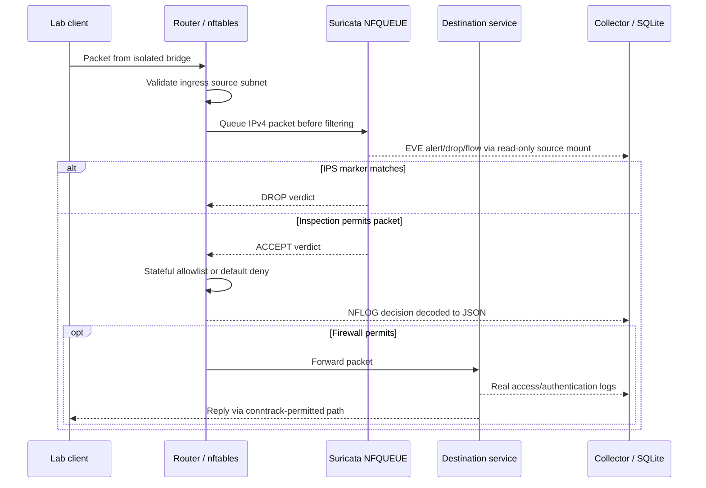

# Architecture and data flow

The lab favors one small reusable Debian image and ten Compose services over
nested firewall VMs. It runs on a normal Linux developer machine without a
hypervisor appliance or Elasticsearch. Services are separated by network role;
only the firewall routes.

`services/base/Dockerfile` installs maintained packaged software. Entrypoints
configure routes and endpoint ACLs, then drop NET_ADMIN/NET_RAW from service
process bounding sets. Bootstrap capabilities remain available to Docker exec
for the trusted operator; this is documented rather than treated as a hostile
root sandbox. No container mounts the Docker socket or uses privileged mode.

The log collector tails complete lines from five sources, records byte offsets
and inodes in the same SQLite transaction as inserted events, and resumes after
restart. A replacement/truncated file resets the corresponding offset. Invalid
JSON stops ingestion of that source and marks health unhealthy instead of
silently discarding evidence. The newest 100,001 normalized events are retained.
Original event data remains nested under `raw`; Suricata's original EVE files are
also retained. Log transport uses read-only mounts, requiring no cross-VLAN log
port. This is an explicit lightweight alternative to a shipper/search-engine
stack, with filters, event counts and a dashboard.

The firewall uses the kernel's NFLOG group 5. Tcpdump/libpcap streams binary
DLT_NFLOG records; Python decodes netlink attributes and IPv4 headers, preserving
rule ID/action, timestamp, addresses, ports and protocol. Ordinary tcpdump text
output omits NFLOG prefixes and is therefore unsuitable for policy attribution.

Startup order: firewall/listener -> Suricata -> routed endpoints -> health checks.
NFQUEUE does not use bypass; packets fail closed until the sensor is ready.
A firewall restart requires recreating the sensor namespace too; use down/up.

Design references: [Docker internal networks](https://docs.docker.com/reference/compose-file/networks/),
[Docker bridge options](https://docs.docker.com/engine/network/drivers/bridge/),
[Suricata configuration](https://docs.suricata.io/en/suricata-7.0.10/configuration/suricata-yaml.html),
[EVE JSON](https://docs.suricata.io/en/suricata-7.0.10/output/eve/eve-json-output.html).
